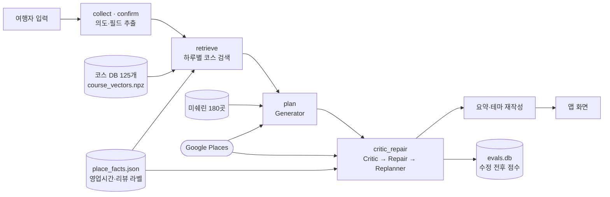
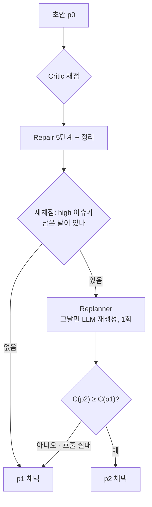

# SeoulFit

외국인 여행자를 위한 서울 여행 일정 앱입니다. 공공 관광 코스 데이터에서 하루의 뼈대를 찾고(RAG), LLM이 그 위에 일정을 쓴 뒤, 코드가 시간·거리·영업시간을 검사하고 고칩니다.

- 앱: Flutter (`lib/`)
- 서버: FastAPI + LangGraph (`backend/`). 설치와 실행은 [backend/README.md](backend/README.md)

## 시스템 아키텍처

**원칙은 정답이 있는 판단은 코드가, 정답이 없는 판단은 LLM이 하는 것입니다.** "경복궁이 화요일에 쉬는가"는 데이터로 답이 나오므로 Python 규칙이 맡고, "이 여행자에게 어떤 코스가 맞는가"는 LLM이 맡습니다.



노드 사이에는 `TravelState` 하나가 전달됩니다(`backend/graph.py · build_graph`).

### 데이터

| 파일 | 규모 | 쓰임 |
|---|---|---|
| `dataset/course_data_v6.json` | 코스 125개, 방문 순서 551개, 고유 POI 374곳 | Visit Seoul·Visit Korea 추천 코스를 하루 단위로 정리. 하루의 뼈대 |
| `dataset/course_descriptions.json` → `course_vectors.npz` | 125 × 3072 | 코스마다 "어떤 여행자에게 맞는가" 한 문장(`purpose`)을 임베딩 |
| `dataset/restaurant.json` | 180곳 | 미쉐린 서울 식당. 점심·저녁의 1순위 후보 |
| `dataset/place_facts.json` | 490곳 | 코스 POI·미쉐린 식당의 Google 영업시간, 폐업 여부, 리뷰 기반 라벨(영어 응대, 현금 전용, 예약 필수, 문화 마찰). `scripts/enrich_place_facts.py`로 오프라인 생성 |
| Google Places (실시간) | – | 코스로 다 못 채운 자리의 보완 장소, 2순위 식당, `place_facts`에 없는 장소의 영업시간 |

코스를 읽을 때(`retrieval.load_courses`) 폐업한 POI는 빼고, 빈 휴무 요일은 Google 영업시간으로 채웁니다. 이 병합을 한 곳에서 하므로 프롬프트, 후보 풀, Critic이 모두 같은 정보를 봅니다.

### 1. 검색 (retrieve)

1. **지역 필터**: 그날 지역에 POI가 하나라도 있는 코스만 후보가 됩니다. 유사도가 높아도 다른 지역 코스는 제외합니다.
2. **순위**: 질의 임베딩과 코스 벡터의 내적으로 상위 3개를 고릅니다. 125개라 근사 검색 없이 전수 계산합니다.
3. **LLM Judge**: 후보 3개 중 하나를 고르거나, 맞는 코스가 없으면 `null`을 냅니다. 유사도 숫자만으로는 "맞는 코스 없음"을 구분하지 못했기 때문입니다. 코스가 채우지 못하는 요청은 Google Maps 검색어(1~2개)로 적고, 이 검색어는 그날 지역에서만 실행됩니다.

### 2. 생성 (plan, Generator)

1. **식사 먼저 확정**: 날마다 저녁, 점심 순으로 미쉐린 → Google → 비움 순서로 정합니다. LLM에게는 식당을 넣지 말라고 지시합니다.
2. **Gemini 호출**: 하루마다 따로, 최대 6개를 병렬로 부릅니다. 규칙은 제공된 목록의 장소만 쓰고, 이름·좌표를 그대로 복사하고, 장소마다 우선순위 1~3을 매기는 것입니다.
3. **검증기**: 목록 밖 장소(환각)를 삭제하고, 요청 지역을 강제로 넣고, 확정한 식사를 삽입합니다. 그다음 페이스별 정류장 수를 맞추고(느긋 3~4, 보통 6~7, 빡빡 7~8) 이동 구간을 계산합니다.

### 3. 검사와 수정 (critic_repair)



**Critic**은 점수와 이슈 목록을 냅니다. 점수는 수정 결과를 받아들일지 정할 때, 이슈는 무엇을 고칠지 정할 때 씁니다.

```
C(p) = 0.35·실행 가능성 + 0.35·요청 지역 커버리지 + 0.15·중복 없음 + 0.15·외국인 친화도
```

| 이슈 | 심각도 | Repair 대응 |
|---|---|---|
| `REQUESTED_AREA_UNDER_COVERED` 요청 지역 POI 2개 미만 | high | 지역 보충 |
| `CLOSED_ON_ASSIGNED_DAY` 정기 휴무일에 배정 | high | 같은 지역·유형으로 교체 → 다른 날로 이동 → 삭제 |
| `TOO_FEW_POIS`, `NO_MEAL_SLOT` | medium | 부족한 날 채움, 식사 채움 |
| `DAY_RUNS_LATE` 종료 시각 + 30분 초과 | medium | 정리 단계의 시간 맞춤 |
| `SCATTERED_DAY_ROUTE` 하루 최대 거리 8km 초과 | medium | 정리 단계의 재정렬 |
| `DIET_MEAL_OPEN`, `DIET_MEAL_UNVERIFIED`, `HIGH_FOREIGNER_FRICTION` | medium | 안내만 |
| `DUPLICATE_POIS` | low | 중복 제거 |

**Repair**는 LLM 없이 정해진 순서로 고칩니다: 지역 보충 → 휴무 교체 → 식사 채움 → 부족일 채움 → 중복 제거. 그 뒤 날마다 정리 단계를 거칩니다.

1. `reorder_supplements`: Google 보완 장소를 동선에 맞는 자리로 옮김
2. `fix_lunch_time`: 점심이 11:00–13:30에 오도록 순서 조정
3. `fit_day_to_time`: 마감(기본 22:00, packed 23:00, 야간 목적 24:00, 각 30분 유예)을 넘기면 우선순위 낮은 장소부터 제외
4. `_learn_hours`: `place_facts`에 없는 장소의 영업시간을 Google에서 조회
5. `fix_opening_hours`: 문 닫힌 시각에 도착하는 장소를 그날 중 열려 있는 자리로 옮김
6. `_replace_shut_stops`: 그래도 안 맞으면 같은 지역·같은 유형의 열린 후보로 교체하고, 없으면 제외. 우선순위 1인 장소는 남김
7. `rechoose_meals`: 바뀐 앞뒤 장소에 맞춰 식당 다시 고름
8. `place_facts.tips`: 라벨이 확인된 장소에만 안내 한 줄 추가(현금 전용, 예약 필수, 영어 응대 어려움, 문화 마찰)
9. `compute_transit_legs`: 이동 구간 다시 계산

**Replanner**는 정리 후에도 high 이슈가 남은 날만 LLM에게 한 번 다시 맡깁니다. 다시 만든 날도 같은 Repair와 정리를 거치고, Critic 점수가 떨어지지 않을 때만 채택합니다. 마지막으로 최종 일정 기준으로 요약과 날짜별 테마를 다시 쓰고, 수정 전후 점수를 `evals.db`에 저장합니다.

## 평가: SeoulFit vs GPT

같은 요청을 SeoulFit과 GPT(`gpt-5.6-terra`, 품질 지시 없는 단일 호출)에 주고, 두 일정을 같은 방법으로 채점했습니다. 코드는 `backend/evals/`에 있습니다.

### 공정 벤치마크 원칙

두 시스템의 모든 방문지를 같은 경로로 검증합니다.

1. **Find Place**: Google Places에서 장소 이름으로 검색합니다.
2. **Place Details**: 좌표, 영업시간, 영업 상태, 리뷰(최대 5개)를 받습니다.
3. **Gemini 라벨링**: 리뷰만 보고 영어 지원, 현금 전용, 예약 필요, 문화 마찰, 식이를 1 / 0 / 모름으로 판정합니다.

라벨러는 그 장소가 어느 시스템 일정에서 나왔는지 모르고, 채점에 SeoulFit 내부 DB는 쓰지 않습니다. 단, SeoulFit은 같은 경로로 만든 `place_facts`를 일정 생성에 쓰므로, OH·AB·CF 비교에는 이 점을 함께 밝혀야 합니다.

### 점수 구성

```
Score(p) = (F + ECS + FG) / 3
F   = (MC + TF + OH) / 3                                 실행 가능성
ECS = (RD + VD + SS + CP + FS) / 5                       동선·흐름
FG  = 0.40·LA + 0.20·MB + 0.15·CC + 0.15·AB + 0.10·CF    외국인 친화성
```

| 지표 | 정의 |
|---|---|
| MC 식사 슬롯 | 점심이 11:00–13:30, 저녁이 18:00–20:00에 시작하는 비율 |
| TF 이동 가능성 | 구간마다 여유 시간 ÷ 필요 시간(`max(10, 8 + 7·km)`분)을 구간식으로 점수화 |
| OH 운영시간 | (영업시간 안 방문 + 0.5 × 모름) ÷ 방문지 수. 폐업은 충돌 |
| RD · VD · SS · CP · FS | 평균 구간 거리, 체류 시간 적정성, 방문 순서 효율, 동선 밀집도, 활동 전환 흐름 |
| LA 언어 접근성 | (영어 지원 + 0.5 × 모름) ÷ 방문지 수 |
| MB 이동 복잡도 | 구간 거리별 점수(≤1km 1.0 … >8km 0.2)의 평균 |
| CC 제약 충족 | 식이 제약이 있을 때 식사 방문지별 맞음 1 / 모름 0.7 / 위반 0 |
| AB · CF | 예약·현금 장벽, 문화 마찰이 있는 곳을 일정 노트가 안내했는가 |

세부 정의와 상수는 [backend/evals/README.md](backend/evals/README.md)와 `bench_metrics.py`에 있습니다.

### 시나리오

외국인 여행자 유형 9개(페르소나, 합계 25일)를 두 시스템에 1회씩 실행했습니다.

| ID | 페르소나 | 일수 | 동행 | 페이스 | 식이 | 시작 |
|---|---|---|---|---|---|---|
| PS1 | 첫 방문 문화 | 3 | solo | 기본 | – | 월 |
| PS2 | 비건 푸디 | 2 | couple | 기본 | vegan | 토 |
| PS3 | 할랄 가족 | 4 | family | relaxed | halal | 토 |
| PS4 | 아이 동반 가족 | 3 | family | relaxed | – | 토 |
| PS5 | K-pop 팬 | 2 | friends | packed | – | 월 |
| PS6 | 쇼핑·뷰티 | 1 | solo | packed | – | 토 |
| PS7 | 야간 문화 | 2 | friends | packed | – | 토 |
| PS8 | 5일 혼합 | 5 | couple | 기본 | vegetarian | 월 |
| PS9 | 시니어(영어 약함) | 3 | couple | relaxed | – | 월 |

### 결과

| 지표 | SeoulFit | GPT | Δ | 95% CI | 승/패/무 | p |
|---|---|---|---|---|---|---|
| F | 0.927 | 0.775 | +0.152 | [+0.100, +0.215] | 9/0/0 | 0.004 |
| ECS | 0.886 | 0.821 | +0.065 | [+0.034, +0.098] | 8/0/1 | 0.008 |
| FG | 0.779 | 0.763 | +0.016 | [−0.006, +0.040] | 5/4/0 | 1.000 |
| **Score** | **0.864** | **0.786** | **+0.078** | [+0.058, +0.102] | 9/0/0 | 0.004 |

- SeoulFit이 9개 페르소나 모두에서 앞섰습니다. 우위는 실행 가능성(F)과 동선(ECS)에서 나오고, 외국인 친화성(FG)은 차이가 없습니다.
- 페르소나별 격차는 비건(+0.138)과 야간(+0.121)에서 가장 컸습니다. GPT가 폐업한 식당을 고르거나 식사·시각을 놓친 경우입니다.
- GPT 일정에는 폐업한 장소가 7곳 있었고, SeoulFit은 0곳이었습니다.
- 한계: 페르소나 9개 × 1회라 실행 간 편차는 재지 않았고, 여행 목적 적합도는 지표에 없습니다.

### 재현

`backend/`에서 실행합니다. 결과는 `evals/out/`(git 미추적)에 쌓입니다.

```bash
export LANGSMITH_TRACING=false OUT=evals/out/bench_persona
venv/bin/python scripts/enrich_place_facts.py    # 1회: dataset/place_facts.json
venv/bin/python evals/bench_run.py gen --arm seoulfit --out $OUT --only PS1 PS2 PS3 PS4 PS5 PS6 PS7 PS8 PS9
venv/bin/python evals/bench_run.py gen --arm gpt --out $OUT --only PS1 PS2 PS3 PS4 PS5 PS6 PS7 PS8 PS9
venv/bin/python evals/bench_run.py verify --out $OUT
venv/bin/python evals/bench_run.py score --out $OUT && venv/bin/python evals/bench_run.py report --out $OUT
```
